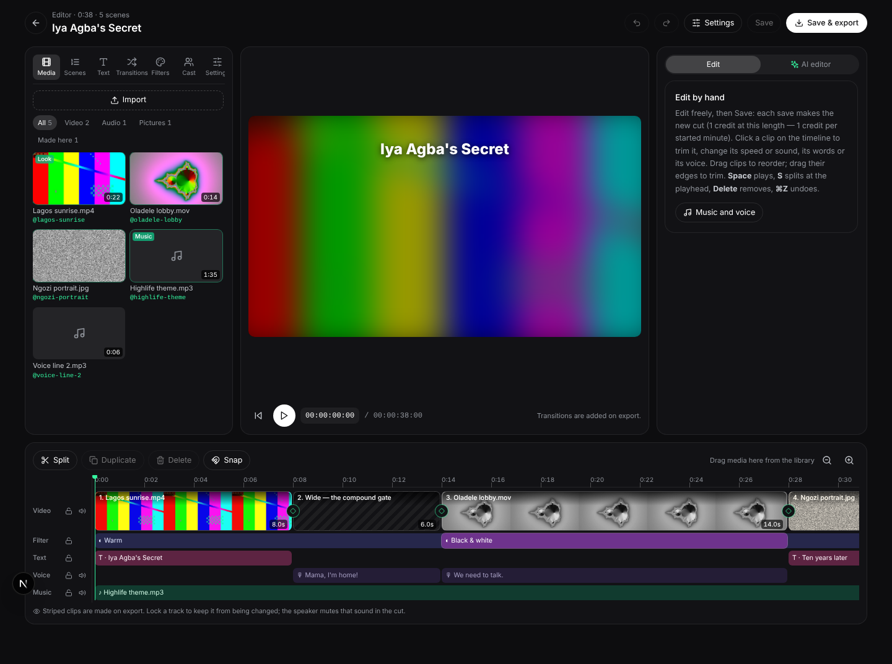

# Video Studio map

Where each part of the video studio lives, for anyone extending it. The
upgrade plan's phases refer to these pieces.

## Pages and components

- `src/app/dashboard/video/page.tsx`: the list of videos and the type picker
  (`src/app/dashboard/components/video/VideoTypeGrid.tsx`).
- `src/app/dashboard/video/[id]/page.tsx`: the studio. Uploads
  (`components/video/MediaPanel.tsx`), the timeline (scenes, with
  `TimelineClip.tsx` for uploaded clips: trim, speed, level, mute, order),
  video settings (`VideoSettings.tsx`), render, preview and export.
- The workspace preview board links to the studio ("Upload clips · timeline
  · video settings").

## Uploads (Phase 1)

1. The browser reads a file's length and size (`lib/video/upload-client.ts`)
   and refuses one over the limits (`lib/video/assets.ts`: clips 400 MB / 3
   min, sound 50 MB, pictures 20 MB).
2. `POST [id]/assets/upload-url` gives a one-time storage address; the file
   goes straight to the private `video-assets` bucket with progress.
3. `POST [id]/assets` registers it: the kind is re-checked from the stored
   object's own MIME type, and `[id]/assets/prepare` (its own 300s function,
   ffmpeg traced in) probes it, makes a working copy (upright, ≤1920, 30 fps,
   H.264, AAC stereo, silence laid in for silent clips) and a poster
   (`lib/video/prepare-asset.ts`).
4. Uploaded clips and pictures become scenes with a `source`
   (`{assetId, trimStart, trimEnd, speed, volume}`); a sound file can be the
   music. A render files them as finished rows (`uploads-render.ts`): nothing
   is generated or charged for them.
5. "Edit my clips" (`clip_edit`) stitches every upload in order at once, free
   (`lib/video/timeline.ts stitchPlan`). With a written brief, the Creative
   Director plans around the uploads from the ATTACHMENTS block.

## Video settings

`lib/video/cut-settings.ts` lists every setting, its options and defaults;
`lib/video/cut-filters.ts` turns them into ffmpeg; `compose-local.ts` runs
it. Saving the timeline or settings (`POST [id]/timeline`) makes a new
version that reuses every clip and line that still fits and re-cuts it,
free.

## API routes (`src/app/api/video/`)

| Route | Does |
|---|---|
| `route.ts` | create and list videos |
| `[id]/route.ts` | one video's whole state (`lib/video/state.ts`), with recovery polling |
| `[id]/plan/route.ts` | the Creative Director's plan, and edits to it |
| `[id]/render/route.ts` | starts a render (`lib/video/start-render.ts`) |
| `[id]/render/callback/route.ts` | n8n's clip and voice results |
| `[id]/render/clip/route.ts` | every clip engine's webhook (Higgsfield, MiniMax, fal Seedance, Runware) |
| `[id]/render/fal/route.ts` | fal's lip sync, avatar, music and compose |
| `[id]/render/line/route.ts` | Runware's lip sync, avatar and music |
| `[id]/render/compose/route.ts` | the cut made on this server (`lib/video/compose-local.ts`) |
| `[id]/file/route.ts` | the final MP4 and its exports |
| `[id]/board/route.ts` | the workspace preview's view |
| `[id]/assets/upload-url/route.ts` | a one-time direct-to-storage upload address |
| `[id]/assets/route.ts` | register an upload (`POST`), remove one (`DELETE`) |
| `[id]/assets/prepare/route.ts` | probe, working copy and poster for an upload |
| `[id]/timeline/route.ts` | save the timeline and settings, re-cut without re-filming |

## The Runware client

`src/lib/runware.ts`. One endpoint and one key. Clips, lip sync, avatars and
music are queued with `deliveryMethod: "async"` and a `webhookURL`, and are
then read back with `getResponse`. Stills and speech are synchronous.

## Attachments and intent

Uploads are `video_assets` rows (`kind`: `video`, `audio`, `image`, or a
picture's role `product`, `person`, `photo`, `reference`; `render` for a
finished cut) with a `storage_path` in `video-assets`, plus their measured
length, size, sound, working copy and poster. The Creative Director and the
chat editor read the ATTACHMENTS block (`attachmentManifest`) before the
person's words; `attachmentIntent` names what a message asks of what is
attached (STITCH, LIPSYNC_VIDEO, EDIT, AVATAR, GENERATE). The workspace's chat edits a video in words through
`lib/video/editor.ts` and `lib/video/apply-edit.ts`.

## Credits

The tables are `credit_plans`, `credit_balances` and `credit_ledger`
(`supabase/schema.sql`). They change only through the `charge_credits()` RPC,
called by `chargeCredits()` in `src/lib/credits-server.ts`, with a dedupe key
per job. A render is checked against the balance before it starts
(`start-render.ts`), and each job is charged when it arrives, never when it
fails. The price of a credit is `topUpPricePerCredit()` in
`src/app/dashboard/credits.ts` (50 for $15).

## Scenes, models and the production line

- **Scene prompts:** `clipPrompt()` in `lib/video/render.ts`, from each
  scene's `motionPrompt` or `visual`. The plan itself comes from
  `lib/video/plan.ts` and `plan-video.ts`.
- **Clip models:** routed per scene in `lib/video/clip-engines.ts`: Runware
  `minimax:h3@0` (`RUNWARE_VIDEO_MODEL`), Higgsfield Seedance 2.0 and Kling,
  MiniMax Hailuo 2.3, fal Seedance 1.5, or n8n.
- **The same face in every shot:** UGC, ad and social on-camera scenes start
  from one creator keyframe per version (`lib/video/frames.ts`).
- **Lip sync, avatar and music:** `lib/video/production.ts`. See
  `docs/MEDIA-ENGINES.md`.

## The visual editor

`/dashboard/video/[id]/edit` (`components/video/VideoEditor.tsx`). A cut
made by hand, the way CapCut works, and none of it needs AI:

- **Preview:** plays the timeline in the browser, with each clip at its
  in-point, speed and level, pictures moving, voice lines, the music and the
  words on screen.
- **Scenes list:** a thumbnail, a status (Ready / Preparing / Made on export
  / Upload missing), move up or down, and take out. Taken-out scenes wait in
  a tray to be put back with one tap.
- **Timeline:** four labelled tracks (Video, Words, Voice, Music). Drag a
  clip to reorder it, drag its edges to trim, split at the playhead (S),
  duplicate, take out, undo and redo (⌘Z / ⇧⌘Z), and zoom.
- **Inspector:**
  - A clip: trim, speed, level, mute, words on screen.
  - Its voice-over: any of 30 voices (`lib/video/voices.ts`), made now or
    on export, or the person's own recording.
  - The music: none, made on export, made now from a prompt (a song when
    lyrics are given), or any audio upload; its level, start point and
    ducking. Also one voice for every line.
- **AI editor:** optional, one credit per answer (`POST [id]/assist`). It
  reads the ATTACHMENTS block, the timeline on screen and the settings, and
  its proposal lands on the timeline to keep or undo. It can reorder, trim,
  re-voice, change settings and add uploads.

The deterministic operations live in `lib/video/editor-timeline.ts` (pure,
checked offline). Music and voice made on request go through
`POST [id]/audio` and become audio uploads that can be reused and swapped.

## Characters: the same person in every scene

A character belongs to the person and is reused across all their videos
(`video_characters`). It has a name, a fixed description, reference pictures
made once, and a voice.

- **Reference sheet:** made once, when the character is created
  (`lib/video/characters.ts makeSheet`). Seedream 4.5 makes a front portrait
  from the description, or the person's own photo is used as the front
  (only after they confirm the likeness; `consent_at` is recorded). The
  three-quarter and full-body views are made from that front picture, so the
  face is the same in all of them. Pictures are never made again per scene.
- **Every scene with a character** (`scene.characters`) is filmed in
  reference mode: the same pictures go with every scene, and the
  description is repeated word for word (`lib/video/cast.ts castPrompt`).
  - Engines are tried in order: MiniMax H3, then Seedance 2.0, then any
    engine that can start from the character's front picture
    (`clip-engines.ts routeClip`, `references: true`).
  - H3 goes first because ByteDance's moderation refuses realistic human
    faces as reference pictures.
- **Voices:** a character speaks in their own voice. A line written
  "AMA: …" is read by Ama.
- **Security:** pictures are read from the database for the video's owner
  only. A plan can name a character id, but never where its pictures are
  stored.
- **The video's cast:** `video_projects.character_ids` holds who is in the
  video; `POST [id]/cast` sets it. The Creative Director and the editor read
  a locked CHARACTERS block and tag each scene with who is in it.

## The AI agent

Planning, chat edits and the editor's assistant run on the model the person
picked: the workspace composer's picker, or the editor's AI picker (stored
on the device under `qs-video-agent`). `lib/video/agent.ts` checks that the
plan includes the model and charges at its rate (`creditMultiplierFor`).
Otherwise it falls back to the studio's default and says so.

## Scene-to-scene continuity

A scene that carries straight on from the one before starts where that one
ended (`lib/video/continuity.ts`).

- **Which scenes carry on:**
  - a scene marked `continues: true`, set by the planner, the editor or the
    split of a long shot;
  - otherwise a scene that shares a character with the scene before.
  - `continues: false` keeps a scene apart, and `cut.continuity: false`
    turns continuity off for the whole video.
- **The render:** a continuing scene's row waits as `queued` with provider
  `await:<scene>`.
  - When the scene before lands, `continuity-release.ts` calls
    `/api/video/[id]/render/continue` (`continue-scene.ts`, ffmpeg bundled).
  - That route takes the last frame and films the scene from it. A character
    scene gets the frame as one more reference picture, after the
    character's own. Any other scene gets it as its first frame.
  - If the scene before failed, the waiting scene is filmed as it would have
    been anyway.
  - A hand-off that gets lost is recovered when the studio polls.
- **Speed:** only linked scenes are made one after another. Every other
  scene is still made at once, so a render takes as long as its longest run
  of linked scenes, which the Settings panel shows.

## Many characters

- **Limits:** a video can have up to 12 characters, and one scene up to 9
  (the nine reference-picture slots, at least one each).
- **Sharing the pictures** (`planReferences`): every character in the scene
  gets their front picture first, then extra angles go round in turn. The
  pictures stay grouped by character, and the prompt says which are whose
  ("Reference images 1–3 show Ama: …").
  - A tenth person is still described word for word.
  - A continuing scene's last frame only takes a spare slot, never a
    character's only picture.
- **The script decides the cast** (QA in `plan.ts`):
  - Anyone the script names in a scene (as a name, not an ordinary word) is
    added to that scene.
  - A line with several speakers ("AMA: … KOFI: …") becomes one shot per
    speaker. Each shot keeps the full cast, is read in that speaker's voice,
    and carries on from the one before.
- **Live test:** a two-person scene (Ama and Kofi) on MiniMax H3, landscape,
  kept both people exactly and never swapped them.

## What everything costs (no free work)

`lib/video/pricing.ts`. Every price is checked against the balance before
the work starts, because `charge_credits` always lands, short or not. Each
is charged once, when the work is delivered.

| Work | Credits |
|---|---|
| The cut (every render, every saved edit, every setting change, every Sound switch) | 1 per started minute of the finished video |
| "Edit my clips": uploads laid out as a timeline | 1 |
| Preparing an upload | 0.5 per video clip, 0.1 per picture or sound file |
| The AI's look-over of an edit | 0.5 × the agent's rate |
| AI answers, plans, edits | 1 × the agent's rate (agent.ts) |
| Generated clips, voices, lip sync, music, characters | as before (engines.ts) |

## Smart suggestions

With "Smart suggestions" on (the default, kept per device), the AI looks
over each saved edit (`POST [id]/review`, `editor.ts reviewEdit`).

- When all is well it stays quiet.
- Otherwise it shows up to three short suggestions, each a ready change to
  Apply or Dismiss.
- A suggestion made against a timeline that has changed since is asked
  again against the current one.
- With too few credits the look-over is skipped, so nobody is asked to top
  up for something they didn't ask for.

## Long films (up to 60 minutes), references and continuations

- **Length.** Cinematic films offer 5, 10, 30 and 60 minutes; explainers up to 10. A plan holds up to 600 scenes (`MAX_PLAN_SCENES`).
- **Planning** (`director.ts directFilm`). A film over 3 minutes is outlined first (chapters of about 4 minutes, with the locks, voice and music), then every chapter's scenes are written at once, each told the whole outline and how the chapters beside it end and begin. Each call is charged (`agentCost(PLAN_COST) × calls`).
- **Filming.** Scenes are sent 8 at a time. Scenes linked only by a shared character restart every `MAX_AUTO_RUN` (6), so a long film is never made one clip after another; a scene marked `continues: true` always carries on.
- **The cut** (`chapters.ts`, `compose-local.ts`). Up to 150 s is cut in one run, as before. Longer:
  - the film is split into chapters of about 2 minutes, never inside a linked run;
  - every chapter is cut at once, each in its own `/render/compose?part=k` run, with its stretch of the (looped) music and one loudness, and stored as `part-NNN.mp4`;
  - the last part to finish starts `?part=join`, which joins the parts by copying (no re-encode) and streams one MP4 straight into storage (`stream-upload.ts`, resumable upload in 6 MB pieces), so it never needs the server's disk;
  - if the single file cannot be stored, the compose row says `parts:<count>:<base>`, and the studio plays the parts straight through, each downloadable.
- **Uploads.** Clips up to an hour (still 400 MB). Over 3 minutes, a clip gets no working copy and the cut reads only the part it uses, where it is stored. Each clip gets three reference frames (`analysis.frames`).
- **Use as look** (`plan.referenceClips`, `look.ts`). Every generated scene is sent the marked clips' frames after the characters' own pictures, with a prompt line to match their setting, light, colour and people. The director sees those clips' frames first.
- **Continue it** (`timeline.withContinuation`, `continuity.ts`). A generated scene after an upload with `continues: true` starts on the upload's frame at its trim end (a picture is its own frame). Also available to the AI editor (`continueFrom`, `look`).

## The editor's layout (`/dashboard/video/[id]/edit`)

- **Library (left, `EditorLibrary.tsx`):** Media (a grid by kind — All, Video, Audio, Pictures, Made here — each tile showing its length and `@name`; drag it onto the timeline or double-click to add it at the end), Scenes (in order: jump, reorder, take out, put back), Text (the selected clip's words, the end card, caption style), Transitions (a tile per transition, length, fade in/out), Filters (a look for the selected clip — `scene.color` — or the whole video), Cast, Settings.
- **Preview (centre):** plays the timeline as it stands, with each clip's filter and words; timecode in hours:minutes:seconds:frames.
- **Right:** the selected clip or sound (Edit), or the AI editor, in two tabs.
- **Timeline (bottom, full width):** Video, Filter, Text, Voice and Music tracks. Each has a lock (the keyboard respects it too); Video, Voice and Music have a mute. Clips show as filmstrips; ones still to be made are striped; diamonds between clips open Transitions; trims snap to the playhead and other clips (Snap); media dropped from the library lands where it is dropped.
- **Phone:** preview, timeline, library, inspector, one under another.
