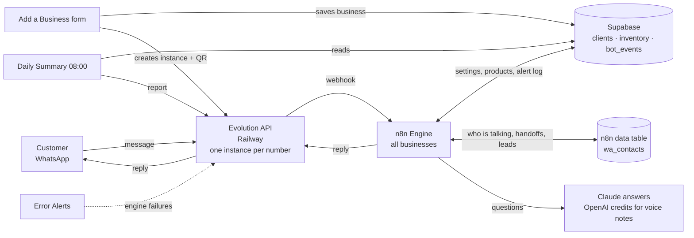

# WhatsApp Bot — Configuration Map

How the multi-business WhatsApp assistant is wired, what each piece does, and
how to add a new business, or move the whole bot to a new n8n with one click. The same content
as a printable PDF: [WhatsApp-Bot-Configuration-Map.pdf](WhatsApp-Bot-Configuration-Map.pdf).

## The 30-second version

- **One engine, many businesses.** A single n8n workflow answers WhatsApp for
  every business. Nothing about a business lives in the workflow: it all lives
  in that business's row in Supabase `clients` and its products in `inventory`.
- **Each business = one WhatsApp number = one Evolution "instance".** The
  instance name is how the engine knows which business a message is for.
- **Adding a business:** fill in the *Add a Business* form and scan a QR code,
  or do it by hand (see [Add a new business](#add-a-new-business)).
- **Changing a business** (prices, products, hours, tone, on/off): open the
  *Edit a Business* form, change the pre-filled page and press **Save changes**.
  Changes apply to the next message. Menus and custom AI instructions are edited
  in Supabase.

## System map



A message travels from the phone to Evolution (the WhatsApp connection), then
to the engine webhook. The engine looks up the business and the customer's
state, asks Claude if needed, and sends the reply back out through Evolution.

## 1. Accounts, addresses and keys

No keys are written here; the last column says where each one lives.

| Service | Used for | Address / id | Where the key lives |
| --- | --- | --- | --- |
| n8n Cloud | Runs the 4 workflows | https://dynamit3.app.n8n.cloud | Your n8n login; credentials are stored in n8n |
| Evolution API (Railway) | WhatsApp connection for every business number | https://evolution-api-production-4056.up.railway.app (manager: `/manager`) | Railway → project **thriving-peace** → service **evolution-api** → Variables → **AUTHENTICATION_API_KEY** (global key) |
| Supabase | Business settings, products, alert log | project ref `esuatccbicekcohzgcvd` | n8n credential **Supabase account** (OAuth sign-in) |
| Anthropic (Claude) | AI answers | Claude Sonnet | n8n credential **Anthropic account** |
| OpenAI via n8n credits | Voice notes → text | — | Built-in n8n gateway credits |
| Stripe / Paystack | Payment links sent to customers | `inventory.payment_url` per product | Your Stripe / Paystack dashboard |
| Gmail (optional) | Email copies of alerts | — | n8n credential (Sign in with Google); the Email Alert step stays off until it's connected |

**Credentials inside n8n**

| Credential | Type | Setup | Used by |
| --- | --- | --- | --- |
| Header Auth account | Header Auth | Name `apikey`, Value = Evolution global key | Every Evolution call: send, fetch photo/voice, create instance, follow-ups, daily report |
| Supabase account | Supabase OAuth2 | Sign in to Supabase, allow the project | Client lookup, stock steps, Log Event, live_services, Add a Business, Daily Summary |
| Anthropic account | Anthropic | Paste an Anthropic API key | The Claude step under AI Assistant |

**Important addresses**

| What | Address |
| --- | --- |
| Engine webhook (every Evolution instance sends here) | `https://dynamit3.app.n8n.cloud/webhook/faa757c3-e220-420d-bd89-803d5393f58e` |
| Add a Business form (n8n login needed) | https://dynamit3.app.n8n.cloud/form/ca2ecfe7-8d12-4a43-ba77-14a218798100 |
| Evolution manager | https://evolution-api-production-4056.up.railway.app/manager |

## 2. The engine, stage by stage

Workflow **WhatsApp Bot — Engine (all businesses)**. Two triggers: **Webhook**
(every WhatsApp message) and **Every Hour** (follow-ups).

| Stage | n8n steps | What happens |
| --- | --- | --- |
| 1 · Receive | Webhook → Parse Command → Settings | Keeps only new messages (`messages.upsert`). Drops groups, statuses and the bot's own replies. Reads the number, text, photo or voice note. A message your team types on the business phone is marked "agent". **Settings** reads the Evolution address and Supabase project from `wa_settings`. |
| 2 · Which business? | Fetch Client Config → Client Active? → Business Profile | Finds the `clients` row whose `instance_name` matches the instance. Stops if there is none or `active` is false. Builds the menu, and the AI instructions if `ai_prompt` is empty. |
| 3 · Who is talking? | Get Contact → Decide → Save Contact → Should Reply? | Loads the customer's state from `wa_contacts` (key `instance:phone`). Decide picks the command and handles handoff, `#close` and the spam limit. State is always saved; if the bot should stay quiet, it stops here. |
| 4 · Route | Route Command | Stock, sell/restock, reports (list/low/services), AI questions, or a fixed reply. |
| 5 · AI answers | Has Voice? → Fetch Voice → Voice File → Transcribe Voice → Use Transcript; Has Photo? → Fetch Image → Photo File; AI Assistant (+ Claude, Conversation Memory, live_services) | Voice notes become text first. The AI sees the business instructions, the customer's name, the recent chat, and live products, prices and payment links. It tags hot leads `[[LEAD]]`. |
| 6 · Write the reply | Compose Reply | Writes every message: menu, about, products with Pay links, stock desk, receipts, handoff, chat closed. Also writes the owner-alert text. |
| 7 · Alerts & logging | New Contact Alert → Expand Recipients → Loop Over Recipients → Send WhatsApp Message → Wait Between Sends; Has Alert? → Log Event / Email Alert; Is Lead? → Mark Lead | Sends the reply, alerts every `alert_numbers` phone, logs to `bot_events`, emails (when Gmail is on) and marks leads for follow-up. |
| 8 · Follow-ups (hourly) | Every Hour → Get Clients → Recent Leads → Due Follow-ups → Send Follow-up → Mark Followed | A lead who went quiet 24–48 hours ago gets one check-in. Never sent while a person is handling the chat. |

**Companion workflows**

| Workflow | Trigger | Steps |
| --- | --- | --- |
| WhatsApp Bot — Add a Business | Form (n8n login) | Prepare Business → Create Client → Any Services? → Split Services → Create Products → Create WhatsApp → Scan to Connect (QR) |
| WhatsApp Bot — Daily Summary | 08:00 Africa/Lagos | Get Clients → Last 24h Events → Build Summary → Send Summary |
| WhatsApp Bot — Error Alerts | Engine failure | Compose Alert → WhatsApp the Owner. Must be published and set as the engine's Error Workflow. |
| WhatsApp Bot — Setup / Move | Form (n8n login) | Ensure wa_settings → Ensure wa_contacts → Work Out Settings → Clear Old Settings → Save Settings → Get Businesses → Businesses To Repoint → Point WhatsApp Here → Build Report. See [Move to a new n8n](#move-to-a-new-n8n-one-click-setup). |

## 3. How the bot behaves

| Customer sends | Bot does |
| --- | --- |
| hi, hello, menu, help, 0, start | Welcome and menu: options 1–4 come from the business, 5 = Talk to a person |
| 1–4 (also "option 3", "#3") | That menu option: `about` shows clients.about, `services` shows the products list, `ask` puts the option's question to the AI |
| 5, "talk to a person", human, agent | Tells the customer the team is coming, alerts the owner, then stays **silent** in that chat |
| Any question | AI answers from the business info and live products; hot leads alert the owner |
| Photo / voice note | AI looks at the photo / reads the transcript, then answers |
| More than 8 messages a minute | Ignored |

| Owner / staff (`alert_numbers`) send | Bot does |
| --- | --- |
| 6, staff, desk | Stock desk menu |
| list · low | All stock · items with 5 or fewer left |
| stock rice | Availability and price |
| sell rice 2 · restock rice 10 | Updates the quantity, confirms, alerts the other owners (with a low-stock warning) |

**Handing a chat to a person**

The bot goes quiet when the customer picks 5, or as soon as anyone replies from
the business phone. It comes back when any of these happens:

- the team sends `#close` (immediate)
- nobody writes for 1 hour after the team's last reply
- nobody from the team replies within 24 hours
- the customer types `menu`

**Alerts:** New contact · New lead · Person requested · Assistant couldn't answer
· New sale / Restock. All of them are stored in `bot_events` and counted in the
08:00 report.

## 4. What you edit per business

The quick way is the **Edit a Business** form: type the business name, change
the pre-filled page (one product per line: `Name | price | stock | payment link |
description`; add a line to add a product, delete a line to remove it) and press
**Save changes**. Everything below can also be edited directly in Supabase.


**`clients`**: one row per business.

| Column | Required | What it does |
| --- | --- | --- |
| client_id | yes | Unique id (e.g. `mama_tee_bakery`); links the business to its products and events |
| instance_name | yes | Must match the Evolution instance name exactly |
| business_name | yes | Shown in the welcome, alerts and AI answers |
| alert_numbers | yes | Owner/staff numbers with country code, no +. Format: `{2348012345678,2348098765432}` |
| about | recommended | The "About" option and the AI's main knowledge |
| faqs | recommended | Hours, location, delivery fees, how to pay, policies |
| tone | optional | How the AI should sound |
| tagline · website | optional | Shown under the welcome and in the footer |
| currency | default NGN | Used to format prices |
| menu | optional | Up to 4 options (JSON below). Empty = About · Products & prices · How to order & pay · Hours & location |
| ai_prompt | optional | Full custom AI instructions. Leave empty to build them from about + faqs + tone (recommended) |
| services_note | optional | Extra line under the products list |
| alert_email | optional | Where email alerts go (once Gmail is connected) |
| daily_summary | default true | `false` = no 08:00 report |
| active | default true | `false` = the bot stops answering for this business; nothing is deleted |

Example `menu`:

```json
[
  {"emoji": "🎂", "label": "Cakes & prices", "action": "services"},
  {"emoji": "🚚", "label": "Delivery areas", "action": "ask", "question": "Where do you deliver and how much is it?"},
  {"emoji": "💳", "label": "How to pay", "action": "ask", "question": "How can I pay?"},
  {"emoji": "ℹ️", "label": "About us", "action": "about"}
]
```

**`inventory`**: one row per product or service. Columns: `client_id`,
`item_name` (unique per business), `price` (number only), `quantity` (0 =
unavailable), `description`, `payment_url` (any checkout link).

Filled by the bot, read-only for you: `bot_events` (every alert) and the n8n
data table `wa_contacts` (one row per business + customer).

## Add a new business

Before you start, have ready:

- the business's WhatsApp phone, on a number not linked to another bot
- the owner's number(s)
- a short description, FAQs and the product list

### Option A: the form (2 minutes)

1. Log in to n8n and open the [Add a Business form](https://dynamit3.app.n8n.cloud/form/ca2ecfe7-8d12-4a43-ba77-14a218798100).
2. Fill it in. Products go one per line: `Name | price | stock | payment link | short description`.
3. Scan the QR code shown with the business phone: WhatsApp → Settings → Linked devices → Link a device.
4. Send "hi" to the business number from another phone. The menu should arrive, and the owner should get a "New contact" alert.

If the QR code expires, open the Evolution manager, find the instance and press
**Get QR code**. If the page says "WhatsApp not created", the business is
already saved; finish with steps B3–B4.

### Option B: by hand

**B1. Add the business.** In Supabase → SQL Editor:

```sql
insert into public.clients
  (client_id, instance_name, business_name, alert_numbers, about, faqs, tone, currency, tagline)
values
  ('mama_tee_bakery', 'mama_tee_bakery', 'Mama Tee Bakery',
   '{2348012345678}',
   'Fresh bread, cakes and small chops in Lekki, Lagos.',
   'Open Mon-Sat 8am-7pm. Delivery in Lekki N2,000. Pay by transfer: GTBank 0123456789.',
   'Friendly Nigerian English; reply in Pidgin if they do.',
   'NGN', 'Fresh bread & cakes, delivered in Lekki');
```

**B2. Add products:**

```sql
insert into public.inventory (client_id, item_name, price, quantity, description, payment_url) values
  ('mama_tee_bakery', 'Birthday cake 8 inch', 25000, 10, 'Vanilla or chocolate', null),
  ('mama_tee_bakery', 'Small chops tray', 15000, 20, '50 pieces', 'https://paystack.com/pay/xyz');
```

**B3. Create the WhatsApp instance** in the Evolution manager:

1. Log in with the global key.
2. **Instance +**. Name: exactly the `instance_name` from B1. Channel: Baileys.
3. Open the instance → **Events → Webhook**:
   - Enabled: on
   - URL: the engine webhook (see [Important addresses](#1-accounts-addresses-and-keys))
   - Webhook by Events: off
   - Webhook Base64: off
   - Events: only **MESSAGES_UPSERT**
4. Click **Save** at the bottom of the page.

**B4. Connect.** Press **Get QR code** and scan it from the business phone. The
status should change to Connected.

**B5. Test.** Send "hi" from another phone. The menu should arrive, and the run
shows up under the engine's **Executions** in n8n.

## Move to a new n8n (one-click setup)

Use this when you switch n8n accounts, for example when credits run out. Your
businesses, products and WhatsApp numbers stay where they are, in Supabase and
Evolution. You only move the n8n part, which takes about 10 minutes.

Nothing install-specific is written into the workflows. The Evolution address,
Supabase project, engine address and your alert number all live in one n8n data
table, `wa_settings`, and the **Setup / Move** form fills it in for you.

### 1. Create the three logins (n8n → Credentials → Create)

Use **exactly these names**, so imported workflows find them automatically:

| Name | Type | Fill in |
| --- | --- | --- |
| `Header Auth account` | Header Auth | Name: `apikey` · Value: the Evolution global key (Railway → evolution-api → Variables → `AUTHENTICATION_API_KEY`) |
| `Supabase account` | Supabase OAuth2 API | Sign in to Supabase and allow the project |
| `Anthropic account` | Anthropic | An Anthropic API key |

### 2. Import the six workflows (Workflows → Import from file)

All six are in this folder:

1. [`1-setup-move.workflow.json`](1-setup-move.workflow.json)
2. [`2-engine.workflow.json`](2-engine.workflow.json)
3. [`3-add-a-business.workflow.json`](3-add-a-business.workflow.json)
4. [`4-daily-summary.workflow.json`](4-daily-summary.workflow.json)
5. [`5-error-alerts.workflow.json`](5-error-alerts.workflow.json)
6. [`6-edit-a-business.workflow.json`](6-edit-a-business.workflow.json)

If a step shows a red credential warning after import, open it and pick the
login with the matching name.

### 3. Click the button

Open **WhatsApp Bot — Setup / Move**, publish it, and open its form. Check the
values (they're pre-filled with today's setup), leave "Engine webhook address"
empty, and press **Set up**. In one go it:

- creates the `wa_settings` and `wa_contacts` data tables
- saves the settings every workflow reads
- points **every business's WhatsApp** at this n8n

The result page lists each business with ✅ or ❌.

### 4. Publish and finish

1. Publish the Engine, Add a Business, Edit a Business, Daily Summary and Error Alerts workflows.
2. In the Engine and the Daily Summary, open Workflow settings → Error workflow and choose **WhatsApp Bot — Error Alerts**.
3. Send "hi" to any business number.

You can run Setup / Move again at any time, for example after changing the
Evolution address. It's safe to repeat.

**Good to know:**

- **Voice notes on n8n Cloud** use n8n's built-in AI credits. On a self-hosted n8n, add an OpenAI login to the **Transcribe Voice** step.
- **Data tables** need an n8n version that has them. Any current n8n Cloud plan does.
- **Chats start fresh after a move.** Chats handed to a person and recent AI memory reset; business data is unaffected.

### Moving Supabase or Evolution too (rare)

- **New Supabase project:** run [`schema.sql`](schema.sql) in its SQL Editor, copy your `clients` and `inventory` rows across, then enter the new project ref in Setup / Move.
- **New Evolution server:** in Railway, deploy the Evolution API template (it brings Postgres and Redis) and set a strong `AUTHENTICATION_API_KEY`. Each business's WhatsApp then needs scanning again (Add a Business, or the manager's **Get QR code**). Enter the new address in Setup / Move.

## Troubleshooting

| Symptom | Check |
| --- | --- |
| No reply at all | Check in this order: (1) the instance is Connected; (2) its webhook URL, MESSAGES_UPSERT, "by events" off and Save; (3) the engine is published; (4) `instance_name` matches and `active` is true; (5) a run appears under n8n → Executions. |
| Run stops early | Stopped at Client Active? means there's no matching clients row. Stopped at Should Reply? means a person is handling the chat (send `#close`) or the spam limit was hit. |
| 401 on send | The Header Auth credential needs Name `apikey` and the current global key as Value. |
| "Sorry, I couldn't answer that just now" | The Anthropic key is out of credit or invalid; see the Claude step's error. |
| Voice notes not understood | The n8n gateway credits are used up; add an OpenAI credential to Transcribe Voice. |
| Wrong prices | Edit that business's `inventory` rows. |
| No 08:00 report | Check Daily Summary is published, `daily_summary` is true and `alert_numbers` is set. |

## Running 250 businesses

- **WhatsApp numbers:** each business needs its own number, which is its own Evolution instance. The engine needs no changes.
- **Evolution server:** every connected number uses memory. Scale the Railway service up as you add businesses.
- **n8n plan:** every message is one run. Choose a plan with enough monthly runs and parallel runs for your busiest hour.
- **AI costs:** menu taps, stock commands and handoffs use no AI. Only free-text questions, photos and voice notes do. Price your plans above that cost.
- **Ban risk:** unofficial WhatsApp connections can be banned for spam. Never send bulk marketing; the one built-in follow-up is the limit.
